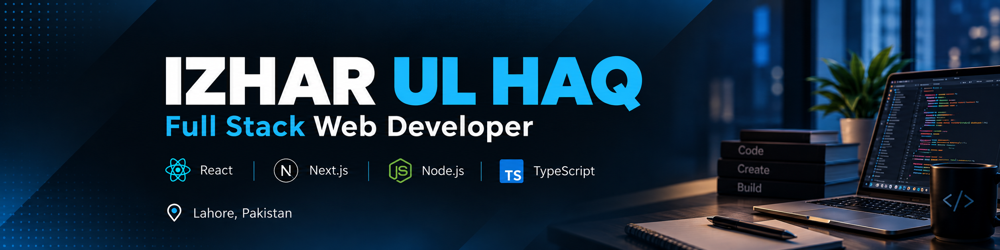

## 👋 Hi, I'm Izhar

I'm a Software Engineering student at **Arid Agriculture University** from Lahore, Pakistan, and I build modern, fast web apps with **React, Next.js, Node.js and TypeScript**. I'm currently exploring **Python and Deep Learning**, and I'm **open to work / internships**.

- 🔭 Building full-stack projects with the Next.js ecosystem
- 🌱 Learning: Deep Learning, system design, TypeScript patterns
- 💬 Ask me about: React, Next.js, WordPress, front-end development

## 🛠️ Tech Stack

## 🚀 Featured Projects

| Project | Description |
|---|---|
| [izhar-portfolio](https://github.com/Izhar583/izhar-portfolio) | My personal portfolio website (TypeScript) |
| [Sada-e-Kutub](https://github.com/Izhar583/Sada-e-Kutub) | Books platform (TypeScript) |
| [ForexCRM](https://github.com/Izhar583/ForexCRM) | CRM dashboard for forex workflows |
| [Toolboxpro](https://github.com/Izhar583/Toolboxpro) | Collection of handy online tools |
| [HidayahFlix](https://github.com/Izhar583/HidayahFlix) | Islamic content streaming UI |
| [Landing-page](https://github.com/Izhar583/Landing-page) | Responsive landing page |

> ✏️ Har project ki description apne hisaab se edit kar lena, meine sirf naam se andaza lagaya hai.

## 📊 GitHub Stats

---

⭐ Thanks for visiting my profile!

